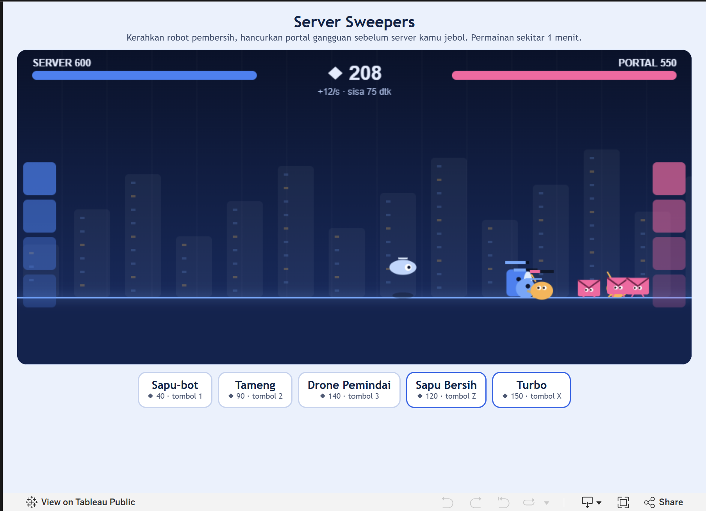

# Server Sweepers

Game pertahanan satu jalur berbasis browser yang hasil permainannya divisualisasikan secara otomatis ke **dashboard Tableau Public**. Repository ini berfokus pada **sistemnya**: bagaimana game, GitHub Pages, dan Tableau Public saling terhubung tanpa server sendiri.

**Demo:** https://ssgream.github.io/server-sweepers/



*(Tambahkan `screenshot.png`, atau hapus baris gambar di atas.)*

---

## Daftar isi

- [Gambaran singkat game](#gambaran-singkat-game)
- [Arsitektur sistem](#arsitektur-sistem)
- [Alur data](#alur-data)
- [Protokol parameter](#protokol-parameter)
- [Komponen](#komponen)
- [Struktur repository](#struktur-repository)
- [Instalasi dan deployment](#instalasi-dan-deployment)
- [Konfigurasi](#konfigurasi)
- [Batasan](#batasan)
- [Pemecahan masalah](#pemecahan-masalah)
- [Privasi](#privasi)
- [Kredit dan lisensi](#kredit-dan-lisensi)

---

## Gambaran singkat game

Pemain mengerahkan robot dan memakai spell dengan mata uang **Insight**. Insight bertambah otomatis dan setiap musuh yang dikalahkan. Tujuannya menghancurkan markas Portal sebelum markas Server hancur, dalam batas waktu 100 detik.

| Tombol | Fungsi |
| --- | --- |
| `1` `2` `3` | Kerahkan robot (Sapu-bot, Tameng, Drone Pemindai) |
| `Z` `X` | Spell (Sapu Bersih, Turbo) |
| `R` | Main lagi |
| `Esc` | Tutup dashboard hasil |

Detail angka (biaya, kesehatan, serangan) ada di konstanta `T`, `E`, dan `SP` di `index.html`.

---

## Arsitektur sistem

Tidak ada backend dan tidak ada database. Semua berjalan di browser pemain.

```
┌───────────────────────────────────────────────────────────┐
│ Browser pemain                                            │
│                                                           │
│  index.html (game, Canvas 2D)                             │
│    ├─ step(dt)  : logika permainan                        │
│    ├─ draw()    : render ke canvas                        │
│    └─ merekam   : g.log, g.ev, g.st                       │
│            │                                              │
│            │ game selesai + klik "Lihat dashboard hasil"  │
│            ▼                                              │
│  showTableau()                                            │
│    └─ <tableau-viz> + 13 <viz-parameter>                  │
│            │                                              │
└────────────┼──────────────────────────────────────────────┘
             ▼
   Tableau Public (workbook publik)
     spine.csv  +  parameter  →  calculated field  →  grafik

   Dihosting oleh: GitHub Pages (file statis)
```

Prinsip utama:

1. **Game dan dashboard terpisah.** Game hanya halaman statis. Dashboard adalah workbook Tableau Public yang ditanam lewat Embedding API.
2. **Data tidak disimpan.** Hasil permainan dikirim sebagai nilai parameter dari browser ke dashboard yang sedang tampil di browser yang sama.
3. **Ada cadangan.** Kalau Tableau tidak termuat, game menampilkan dashboard bawaan yang digambar oleh JavaScript.

---

## Alur data

1. **Perekaman selama bermain.** Game menyimpan tiga struktur di memori:
   - `g.log`: potret per detik, berisi `[detik, insight, hp server %, hp portal %, robot aktif, musuh aktif]`.
   - `g.ev`: daftar kejadian (`kerahkan`, `kalahkan`, `spell`) beserta waktu dan nilainya.
   - `g.st`: penghitung ringkasan (musuh dikalahkan per jenis, robot dikerahkan per jenis, Insight dari musuh, Insight terpakai, spell dipakai).
2. **Permainan selesai.** Hasil ditentukan (menang, kalah, atau waktu habis lalu dibandingkan sisa kesehatan markas), potret terakhir disimpan, dan tombol **Lihat dashboard hasil** muncul di layar game.
3. **Dashboard dibuka (klik tombol).**
   - `dash()` membangun dashboard bawaan (kartu KPI dan grafik SVG).
   - Jika `TABLEAU_URL` terisi, `showTableau()` memuat skrip Embedding API sekali saja, lalu membuat elemen `<tableau-viz>` dengan 13 elemen `<viz-parameter>` berisi hasil permainan.
4. **Tableau siap.** Saat event `firstinteractive` terpicu, dashboard bawaan disembunyikan dan digantikan dashboard Tableau. Kalau event itu tidak pernah terpicu, dashboard bawaan tetap tampil.
5. **Penyesuaian ukuran.** Dashboard Tableau berukuran tetap 1000 x 880, lalu `fitTv()` menskalakannya agar pas selebar pop-up dan menyesuaikan ulang saat jendela diubah ukurannya.
6. **Main lagi.** `reset()` mengosongkan semua rekaman dan dashboard, sehingga tiap permainan menghasilkan dashboard yang berbeda.

---

## Protokol parameter

Game mengirim 13 parameter. Nama harus **persis sama** di workbook Tableau.

| Parameter | Tipe di Tableau | Isi |
| --- | --- | --- |
| `p_hasil` | String | `Menang` atau `Kalah` |
| `p_durasi` | Integer | Lama permainan (detik) |
| `p_kutu`, `p_spam`, `p_glitch` | Integer | Musuh dikalahkan per jenis |
| `p_sapu`, `p_tameng`, `p_drone` | Integer | Robot dikerahkan per jenis |
| `p_insight_musuh` | Integer | Insight yang didapat dari musuh |
| `p_insight_terpakai` | Integer | Insight yang dibelanjakan |
| `p_hp_server` | String | Deret kesehatan server per detik |
| `p_hp_portal` | String | Deret kesehatan portal per detik |
| `p_insight` | String | Deret Insight yang dimiliki per detik |

### Pengodean deret per detik

Tiga parameter bertipe deret dikodekan sebagai **satu string tanpa pemisah, tiap nilai tepat 3 angka**, dengan nilai dibatasi 0 sampai 999.

```
Deret  : 100, 98, 95
Dikirim: "100098095"
```

Alasannya: fungsi `SPLIT` di Tableau mewajibkan argumen nomor token berupa angka tetap, sehingga tidak bisa dipakai untuk mengambil nilai ke-N berdasarkan field `[Detik]`. Dengan lebar tetap, nilai ke-N dibaca memakai `MID`:

```
IF [Grup] = 'Timeline' AND LEN([p_hp_server]) >= [Detik] * 3
THEN INT(MID([p_hp_server], ([Detik] - 1) * 3 + 1, 3)) END
```

Nilai awal contoh (untuk menguji workbook tanpa game):

```
p_hp_server : 100100098095090088080070065060
p_hp_portal : 100098095090080070055040020000
p_insight   : 160150140180120200150170140160
```

---

## Komponen

### 1. Game (`index.html`)

- Satu file HTML, CSS, dan JavaScript murni. Tidak ada framework dan tidak ada proses build.
- Render dengan Canvas 2D (900 x 420), diperbarui lewat `requestAnimationFrame`.
- Latar belakang opsional dari `game-bg.png` (rasio 900:420). Jika file tidak ada, dipakai latar bawaan yang digambar lewat kode.

### 2. Data kerangka (`tableau/spine.csv`)

Tabel kecil berkolom `grup`, `nama`, `detik` (125 baris). Isinya hanya kerangka, bukan hasil permainan:

| Grup | Isi | Dipakai untuk |
| --- | --- | --- |
| Musuh dikalahkan | Kutu, Spam, Glitch | Batang musuh |
| Robot dikerahkan | Sapu-bot, Tameng, Drone | Batang robot |
| Insight | Dari musuh, Terpakai | Batang Insight |
| KPI | 6 label KPI | Deretan kartu KPI |
| Timeline | `detik` 1 sampai 110 | Grafik garis dan area |

Angka sebenarnya datang dari parameter, lalu dipetakan ke tiap baris oleh calculated field (`CASE [Nama] WHEN ... THEN [p_...]`).

### 3. Workbook Tableau Public

- 5 calculated field: `Nilai Bar`, `Nilai KPI`, `HP Server`, `HP Portal`, `Insight Dimiliki`.
- 6 worksheet: KPI, Musuh dikalahkan, Robot dikerahkan, Insight terkumpul, HP Markas, Insight per detik.
- 1 dashboard berukuran tetap **1000 x 880**. Latar kartu memakai `tableau/dashboard-background.png` sebagai gambar yang melayang di paling bawah, dan tiap worksheet melayang di atas kartunya dengan latar transparan.
- Field `Detik` harus berupa **Dimension** dan dipakai sebagai **Continuous** di grafik garis, supaya tidak dijumlahkan menjadi satu titik.

### 4. Hosting (GitHub Pages)

Situs statis tanpa konfigurasi server. Game diakses lewat alamat `https://`, yang juga menjadi syarat agar skrip Embedding API Tableau bisa dimuat.

---

## Struktur repository

```
server-sweepers/
├── index.html                  # Game + logika perekaman + penanaman Tableau
├── game-bg.png                 # Latar game (opsional, harus satu folder dengan index.html)
├── README.md
├── LICENSE
├── screenshot.png              # Opsional
├── tableau/
│   ├── spine.csv               # Data kerangka workbook
│   ├── dashboard-background.png
│   └── dashboard-background.svg
└── design/
    └── game-bg-template.svg    # Template Figma untuk latar game
```

---

## Instalasi dan deployment

### A. Terbitkan game

1. Buat repository **Public**, unggah game sebagai `index.html`.
2. Buka **Settings > Pages**, pilih **Deploy from a branch**, branch `main`, folder `/ (root)`, lalu **Save**.
3. Tunggu 1 sampai 2 menit. Alamat game muncul di bagian atas halaman Pages.

### B. Siapkan workbook Tableau Public

1. Di Tableau Public Desktop, hubungkan data ke `tableau/spine.csv` (**Connect > Text file**).
2. Buat 13 parameter sesuai [Protokol parameter](#protokol-parameter), dengan **Allowable values: All**.
3. Buat calculated field dan worksheet seperti di [Komponen](#komponen).
4. Susun dashboard 1000 x 880, lalu **File > Save to Tableau Public As...**
5. Ambil alamat dashboard dari **Share > Embed Code** (bagian `src=`), tanpa tanda `?` dan teks setelahnya:

```
https://public.tableau.com/views/NamaWorkbook/NamaDashboard
```

### C. Hubungkan keduanya

Isi `TABLEAU_URL` di `index.html` dengan alamat tadi, commit, tunggu 1 sampai 2 menit, lalu muat ulang dengan `Ctrl+F5`. Mainkan satu permainan sampai selesai dan klik **Lihat dashboard hasil**. Mainkan lagi dengan cara berbeda untuk memastikan angka dan grafik ikut berubah.

### Menjalankan secara lokal

Tidak ada proses build. Buka `index.html` di browser, atau jalankan server statis:

```bash
python3 -m http.server 8000
```

---

## Konfigurasi

| Konstanta (di `index.html`) | Fungsi |
| --- | --- |
| `TABLEAU_URL` | Alamat dashboard Tableau Public. Kosong berarti hanya dashboard bawaan yang dipakai. |
| `BG_URL` | Nama file gambar latar game (bawaan: `game-bg.png`). |
| `TL` | Batas waktu permainan (detik). |
| `CB0`, `BB0` | Kesehatan awal markas Server dan Portal. |
| `T`, `E`, `SP` | Angka robot, musuh, dan spell. |

Untuk mengganti latar game: ubah `design/game-bg-template.svg` di Figma (jaga kaki karakter di garis lantai y = 330 dan area HUD atas tetap tenang), sembunyikan layer panduan, export PNG 2x (1800 x 840) dengan nama `game-bg.png`, lalu unggah satu folder dengan `index.html`.

---

## Batasan

- **Tidak ada agregasi antar pemain.** Dashboard hanya menampilkan hasil satu pemain pada satu sesi. Untuk rekap gabungan dibutuhkan penyimpanan data tambahan (misalnya Google Sheets), dan Tableau Public memperbarui sumber data seperti itu hanya sekali sehari.
- **Bergantung pada Tableau Public.** Kalau layanan atau Embedding API berubah, dashboard Tableau bisa gagal dimuat dan game kembali ke dashboard bawaan.
- **Harus dibuka dari alamat sendiri.** Pada lingkungan yang memblokir skrip dari luar, dashboard Tableau tidak termuat.
- **Deret per detik terbatas 110 detik** mengikuti baris `Timeline` di `spine.csv`, dan nilainya dibatasi 0 sampai 999 oleh format 3 angka.
- **Nama parameter sensitif.** Selisih satu huruf membuat nilai tidak masuk ke workbook, dan dashboard tetap menampilkan nilai contoh.

---

## Pemecahan masalah

| Gejala | Penyebab dan solusi |
| --- | --- |
| GitHub Pages menampilkan 404 | File harus bernama `index.html`, Pages harus aktif, dan tunggu 1 sampai 2 menit. |
| Yang muncul dashboard bawaan, bukan Tableau | `TABLEAU_URL` kosong atau salah, game tidak dibuka dari alamat sendiri, atau dashboard Tableau tidak bisa dibuka tanpa login. |
| Angka di Tableau tidak berubah | Nama parameter tidak persis sama, atau Allowable values belum **All**. |
| Grafik garis kosong atau satu titik | `Detik` belum menjadi Dimension, atau nilai awal parameter masih berformat koma. |
| Latar game tidak berubah | `game-bg.png` tidak satu folder dengan `index.html`, atau browser masih menyimpan versi lama (`Ctrl+F5`). |
| Dashboard tidak penuh selebar pop-up | Pastikan `index.html` versi terbaru sudah terunggah (ada fungsi `fitTv`). |

---

## Privasi

- Tidak ada data pemain yang disimpan di server.
- Hasil permainan hanya dikirim dari browser pemain ke dashboard yang tampil di browser yang sama.
- Workbook di Tableau Public bersifat publik. Jangan menaruh data pribadi di dalamnya.

---

## Kredit dan lisensi

- Konsep terinspirasi dari game *Data Defense* karya Jeb Besecker di Tableau Public. Karakter, kode, dan desain di sini dibuat ulang.
- Kode dan aset dibuat dengan bantuan AI (Claude, Anthropic).
- Lisensi: lihat [LICENSE](LICENSE).
